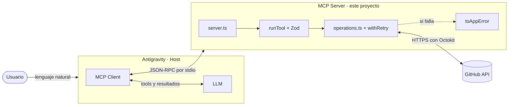

# GitHub MCP Server

Servidor **MCP (Model Context Protocol)** en Node.js y TypeScript que le da a un agente de IA herramientas reales para trabajar con GitHub. Desde **Antigravity**, escribes en lenguaje natural ("crea un issue en mi repo") y el agente ejecuta la acción en tu cuenta de GitHub.

Proyecto Integrador del Módulo 5 de Henry (Full Stack): *AI Agents y Model Context Protocol*.

   

## Contenido

- [Qué hace](#qué-hace)
- [Por qué es útil](#por-qué-es-útil)
- [Arquitectura](#arquitectura)
- [Requisitos](#requisitos)
- [Instalación](#instalación)
- [Configuración](#configuración)
- [Tools disponibles](#tools-disponibles)
- [Ejemplos de uso](#ejemplos-de-uso)
- [Tests](#tests)
- [Scripts](#scripts)
- [Estructura del proyecto](#estructura-del-proyecto)
- [Manejo de errores](#manejo-de-errores)
- [Seguridad](#seguridad)
- [Troubleshooting](#troubleshooting)
- [Licencia](#licencia)

## Qué hace

El server expone **8 tools** de GitHub: las 5 obligatorias y 3 extra.

| Tool | Acción | Tipo |
| --- | --- | --- |
| `create_repository` | Crea un repositorio en tu cuenta | Escribe |
| `create_issue` | Abre un issue con título, descripción y labels | Escribe |
| `list_repositories` | Lista tus repositorios con filtros y paginación | Solo lectura |
| `create_commit` | Crea o reemplaza un archivo con un commit | Escribe (reemplaza el archivo) |
| `list_issues` | Lista los issues de un repositorio, sin pull requests | Solo lectura |
| `create_branch` ⭐ | Crea una branch desde otra | Escribe |
| `close_issue` ⭐ | Cierra un issue como resuelto o no planificado | Escribe |
| `add_comment_to_issue` ⭐ | Comenta en un issue | Escribe |

⭐ = extra credit.

Además:

- Valida cada parámetro con **Zod** antes de llamar a GitHub.
- Traduce los errores técnicos a **mensajes en español** que el agente puede explicar. Por ejemplo, un 404 se convierte en *"El repositorio X no fue encontrado. Verifica el nombre e intenta de nuevo."*
- **Reintenta** con backoff exponencial los errores temporales (red, 5xx, rate limit).
- Escribe **logs estructurados** en stderr, sin exponer el token.

## Por qué es útil

Un **chatbot** te explica cómo crear un issue. Un **agente** lo crea. Este server convierte a cualquier LLM compatible con MCP en un agente que actúa sobre GitHub.

Casos de uso:

- **Arrancar un proyecto:** "Crea un repo `api-pagos` privado y agrega un README con la descripción del proyecto."
- **Reportar bugs sin salir del editor:** "Abre un issue en `api-pagos` sobre el error de login, con label `bug`."
- **Revisar pendientes:** "¿Qué issues abiertos tiene `api-pagos`?"
- **Organizar el trabajo:** "Crea la branch `feature/login` y deja un comentario en el issue #3 diciendo que empecé."
- **Cerrar el ciclo:** "Cierra el issue #3 como resuelto."
- **Documentar rápido:** "Haz un commit que cree `docs/arquitectura.md` con un resumen del proyecto."

## Arquitectura



**Recorrido de una petición** ("crea un issue en mi repo"):

1. El usuario escribe en el chat de Antigravity.
2. Al conectarse, el client ya obtuvo la lista de tools (`tools/list`) con sus JSON Schemas y se la pasó al LLM.
3. El LLM elige `create_issue` y arma los argumentos.
4. El client envía `tools/call` al server por **stdin** (JSON-RPC).
5. `runTool` valida con Zod. Si algo está mal, responde el error sin llamar a GitHub.
6. `operations.ts` llama a GitHub con Octokit, dentro de `withRetry`.
7. Si GitHub falla, `toAppError` traduce el error a un mensaje en español.
8. El server responde por **stdout**: un resumen más los datos, o `isError: true` con el mensaje.
9. El LLM le explica el resultado al usuario.

> **Importante:** con transporte stdio, **stdout** es exclusivo del protocolo. Por eso los logs van a **stderr**, ESLint prohíbe `console.log` y dotenv se carga en modo `quiet`.

## Requisitos

| Requisito | Versión |
| --- | --- |
| Node.js | **20 o superior** para ejecutar (lo exige Octokit 22). Para desarrollar y correr los tests, **22.12 o superior** (lo exige Vitest 5) |
| npm | 10 o superior |
| Cuenta de GitHub | Con un Personal Access Token |
| Antigravity | Para usarlo con un agente (opcional: también funciona con MCP Inspector u otro host MCP) |

Verifica tu versión:

```bash
node -v
```

## Instalación

```bash
git clone https://github.com/dburbanoh-dev/MCP-Henry-PI-5.git
cd MCP-Henry-PI-5
npm install
npm run build
```

`npm run build` compila TypeScript de `src/` a `dist/`. El host ejecuta `dist/server.js`.

## Configuración

### 1. Obtener un GitHub Personal Access Token

**Opción A: token classic** (la que pide el proyecto)

1. Ve a [github.com/settings/tokens](https://github.com/settings/tokens).
2. **Generate new token → Generate new token (classic)**.
3. Ponle un nombre (ej: `mcp-server`) y una fecha de vencimiento.
4. Marca estos **scopes**:

| Scope | Para qué |
| --- | --- |
| `repo` | Crear repositorios, issues, branches y commits; leer repos privados |
| `user` | Leer tu usuario (se usa cuando no indicas `owner`) |
| `admin:org` | Trabajar con repositorios de tus organizaciones |

5. **Generate token** y cópialo. GitHub no te lo vuelve a mostrar. Empieza con `ghp_`.

**Opción B: token fine-grained** (más seguro, con el principio de menor privilegio)

1. En [github.com/settings/personal-access-tokens](https://github.com/settings/personal-access-tokens), **Generate new token**.
2. **Repository access:** *All repositories*. Con *Only select repositories* no se pueden crear repos nuevos.
3. **Permissions → Repository permissions:**

| Permiso | Nivel | Para qué |
| --- | --- | --- |
| Administration | Read and write | `create_repository` |
| Contents | Read and write | `create_commit`, `create_branch` |
| Issues | Read and write | `create_issue`, `list_issues`, `close_issue`, `add_comment_to_issue` |
| Metadata | Read-only | Obligatorio, se marca solo |

El token empieza con `github_pat_`.

### 2. Configurar el `.env`

```bash
cp .env.example .env
```

En Windows (PowerShell): `Copy-Item .env.example .env`.

Edita `.env`:

```env
GITHUB_TOKEN=ghp_tu_token_aqui
LOG_LEVEL=info
```

| Variable | Obligatoria | Valores | Descripción |
| --- | --- | --- | --- |
| `GITHUB_TOKEN` | Sí | Token de GitHub | Autenticación con la API |
| `LOG_LEVEL` | No | `debug`, `info`, `warn`, `error` | Nivel de los logs en stderr. Por defecto `info`. Con `debug` se ve cada request a GitHub |

El server busca el `.env` **en la carpeta del proyecto**, no en la carpeta desde donde se lanza. Así funciona aunque Antigravity lo ejecute desde otro lugar. `.env` está en `.gitignore`: **nunca lo subas a GitHub**.

### 3. Configurar el server en Antigravity

1. En Antigravity, abre el panel del **Agent** y en el menú **⋯** ve a **MCP Servers → Manage MCP Servers → View raw config**. Se abre `mcp_config.json` (en Windows suele estar en `C:\Users\<usuario>\.gemini\config\mcp_config.json`).
2. Agrega el server con la **ruta absoluta** a `dist/server.js`:

```json
{
  "mcpServers": {
    "github-henry": {
      "command": "node",
      "args": ["C:/ruta/a/MCP-Henry-PI-5/dist/server.js"]
    }
  }
}
```

3. Guarda y presiona **Refresh** en *Manage MCP Servers* (o reinicia Antigravity). Debe aparecer **github-henry** con sus 8 tools.

**Sobre el token:** no hace falta ponerlo en `mcp_config.json`, porque el server lo lee del `.env`. Si prefieres pasarlo desde Antigravity, agrega `"env": { "GITHUB_TOKEN": "..." }`; esa variable tiene prioridad sobre el `.env`.

**Si tienes varias versiones de Node** (por ejemplo con nvm), usa la ruta completa del ejecutable en `command`, como `"C:\\Program Files\\nodejs\\node.exe"`, para que Antigravity no use una versión vieja.

### 4. Probar con MCP Inspector (opcional)

[MCP Inspector](https://github.com/modelcontextprotocol/inspector) es una interfaz web para probar el server a mano:

```bash
npm run inspector
```

En el navegador: **Connect → Tools → List Tools**, elige una tool, completa el formulario y haz clic en **Run Tool**.

## Tools disponibles

`owner` es opcional en todas las tools que lo usan: si se omite, se usa el usuario dueño del token.

### `create_repository`

Crea un repositorio en la cuenta del usuario autenticado.

| Parámetro | Tipo | Obligatorio | Por defecto | Reglas |
| --- | --- | --- | --- | --- |
| `name` | string | Sí | | 3 a 100 caracteres; solo letras, números y guiones; sin guion al inicio ni al final |
| `description` | string | No | | Máximo 350 caracteres |
| `private` | boolean | No | `false` | |
| `autoInit` | boolean | No | `true` | Crea un README inicial para que el repo no quede vacío |

> 💬 *"Crea un repositorio privado llamado api-pagos con la descripción 'API de pagos con Stripe'"*

### `create_issue`

Abre un issue en un repositorio.

| Parámetro | Tipo | Obligatorio | Reglas |
| --- | --- | --- | --- |
| `owner` | string | No | Usuario u organización (1 a 39 caracteres) |
| `repo` | string | Sí | Nombre del repo, sin el owner |
| `title` | string | Sí | 1 a 256 caracteres |
| `body` | string | No | Markdown, hasta 65 536 caracteres |
| `labels` | string[] | No | Hasta 20 labels |

> 💬 *"Abre un issue en api-pagos titulado 'Error 500 al pagar con tarjeta' con los pasos para reproducirlo y el label bug"*

### `list_repositories`

Lista los repositorios del usuario autenticado (propios, de colaboración y de organizaciones).

| Parámetro | Tipo | Obligatorio | Por defecto | Valores |
| --- | --- | --- | --- | --- |
| `visibility` | string | No | `all` | `all`, `public`, `private` |
| `sort` | string | No | `updated` | `created`, `updated`, `pushed`, `full_name` |
| `perPage` | number | No | `30` | 1 a 100 |
| `page` | number | No | `1` | 1 o más |

> 💬 *"Lista mis 5 repositorios privados actualizados más recientemente"*

### `create_commit`

Crea o reemplaza **un** archivo de texto con un commit. Si el archivo existe, lo reemplaza completo.

| Parámetro | Tipo | Obligatorio | Reglas |
| --- | --- | --- | --- |
| `owner` | string | No | |
| `repo` | string | Sí | |
| `path` | string | Sí | Ruta relativa a la raíz: sin `/` inicial, sin `..` ni `\` |
| `content` | string | Sí | Contenido completo del archivo |
| `message` | string | Sí | Mensaje del commit, 1 a 500 caracteres |
| `branch` | string | No | Si se omite, la branch por defecto del repo |

> 💬 *"Haz un commit en api-pagos que cree docs/instalacion.md con los pasos para instalar el proyecto"*

### `list_issues`

Lista los issues de un repositorio. Excluye los pull requests, que la API de issues de GitHub también devuelve.

| Parámetro | Tipo | Obligatorio | Por defecto | Valores |
| --- | --- | --- | --- | --- |
| `owner` | string | No | | |
| `repo` | string | Sí | | |
| `state` | string | No | `open` | `open`, `closed`, `all` |
| `labels` | string[] | No | | Filtra por labels |
| `perPage` | number | No | `30` | 1 a 100 |
| `page` | number | No | `1` | 1 o más |

> 💬 *"¿Qué issues abiertos con label bug tiene api-pagos?"*

### `create_branch` ⭐

Crea una branch apuntando al último commit de otra.

| Parámetro | Tipo | Obligatorio | Reglas |
| --- | --- | --- | --- |
| `owner` | string | No | |
| `repo` | string | Sí | |
| `branch` | string | Sí | Nombre válido para git: sin espacios, sin `..`, sin `~^:?*[\` |
| `fromBranch` | string | No | Branch de origen. Si se omite, la branch por defecto |

> 💬 *"Crea la branch feature/login en api-pagos a partir de develop"*

### `close_issue` ⭐

Cierra un issue indicando el motivo.

| Parámetro | Tipo | Obligatorio | Por defecto | Valores |
| --- | --- | --- | --- | --- |
| `owner` | string | No | | |
| `repo` | string | Sí | | |
| `issueNumber` | number | Sí | | Entero, 1 o más |
| `reason` | string | No | `completed` | `completed` (resuelto), `not_planned` (no se hará) |

> 💬 *"Cierra el issue #3 de api-pagos como resuelto"*

### `add_comment_to_issue` ⭐

Agrega un comentario a un issue.

| Parámetro | Tipo | Obligatorio | Reglas |
| --- | --- | --- | --- |
| `owner` | string | No | |
| `repo` | string | Sí | |
| `issueNumber` | number | Sí | Entero, 1 o más |
| `body` | string | Sí | Markdown, 1 a 65 536 caracteres |

> 💬 *"Comenta en el issue #3 de api-pagos que ya empecé a trabajar en la branch feature/login"*

## Ejemplos de uso

Una sesión completa en Antigravity que usa las 8 tools:

| # | Prompt | Tool que usa el agente | Resultado esperado |
| --- | --- | --- | --- |
| 1 | "Lista mis 5 repositorios más recientes" | `list_repositories` | *Se encontraron 5 repositorios (página 1).* y la lista |
| 2 | "Crea un repositorio llamado demo-mcp con la descripción 'Demo del PI'" | `create_repository` | *Repositorio público usuario/demo-mcp creado: https://github.com/...* |
| 3 | "Abre un issue en demo-mcp titulado 'Agregar documentación'" | `create_issue` | *Issue #1 "Agregar documentación" creado: ...* |
| 4 | "Crea la branch docs en demo-mcp" | `create_branch` | *Branch docs creada desde main: ...* |
| 5 | "Haz un commit en la branch docs de demo-mcp que cree docs/guia.md con una guía corta" | `create_commit` | *Archivo docs/guia.md creado en la branch docs. Commit: ...* |
| 6 | "Comenta en el issue #1 de demo-mcp que la guía está en la branch docs" | `add_comment_to_issue` | *Comentario agregado al issue #1: ...* |
| 7 | "Cierra el issue #1 de demo-mcp como resuelto" | `close_issue` | *Issue #1 "Agregar documentación" cerrado como resuelto.* |
| 8 | "Muéstrame los issues cerrados de demo-mcp" | `list_issues` | La lista con el issue #1 |

Y los errores también se explican en lenguaje natural:

| Prompt | Respuesta del server |
| --- | --- |
| "Crea un repositorio llamado ab" | *El nombre del repositorio debe tener al menos 3 caracteres* |
| "Lista los issues de repo-que-no-existe" | *El repositorio usuario/repo-que-no-existe no fue encontrado. Verifica el nombre e intenta de nuevo.* |
| "Cierra el issue #999 de demo-mcp" | *El issue #999 no existe en el repositorio usuario/demo-mcp (o el repositorio no existe). Usa list_issues para ver los números de issue disponibles.* |
| "Crea la branch main en demo-mcp" | *La branch main ya existe en el repositorio usuario/demo-mcp. Elige otro nombre.* |

## Tests

```bash
npm test
```

**71 tests** con [Vitest](https://vitest.dev/). Ninguno llama a GitHub: Octokit se reemplaza por mocks.

| Archivo | Tests | Qué cubre |
| --- | --- | --- |
| `tests/schemas.test.ts` | 27 | Inputs válidos pasan y aplican defaults; inválidos fallan con su mensaje (nombres, rutas, branches, rangos, números de issue) |
| `tests/github.test.ts` | 20 | Operaciones con Octokit mockeado: parámetros enviados a GitHub, 404, 401, 422, branch inexistente o duplicada, issue inexistente |
| `tests/errors.test.ts` | 9 | Transformación de errores HTTP y de red a lenguaje natural, rate limit contra falta de permisos |
| `tests/tools.test.ts` | 8 | `runTool` e integración MCP: un `Client` real del SDK se conecta al server por `InMemoryTransport` |
| `tests/utils.test.ts` | 7 | Reintentos, backoff exponencial, ocultamiento del token y logs en stderr |

Técnicas usadas: `vi.mock("@octokit/rest")`, un Octokit falso con `vi.fn()` inyectado en las operaciones, `vi.spyOn(process.stderr, "write")`, `vi.stubEnv` y funciones `sleep` y `random` inyectadas para que los reintentos sean instantáneos y deterministas.

Modo watch:

```bash
npm run test:watch
```

## Scripts

| Script | Descripción |
| --- | --- |
| `npm run build` | Compila TypeScript a `dist/` |
| `npm run dev` | Ejecuta `src/server.ts` con recarga automática (tsx watch) |
| `npm start` | Ejecuta el server compilado |
| `npm test` | Corre los tests una vez |
| `npm run test:watch` | Corre los tests en modo watch |
| `npm run lint` | Revisa el código con ESLint |
| `npm run typecheck` | Verifica tipos sin compilar |
| `npm run inspector` | Abre MCP Inspector conectado al server compilado |

## Estructura del proyecto

```
src/
├── server.ts                 Punto de entrada: McpServer + transporte stdio
├── types.ts                  Tipos de los resúmenes que recibe el LLM
├── tools/
│   ├── index.ts              Lista de tools, registerTools() y runTool()
│   ├── types.ts              ToolDefinition y formato de respuesta
│   ├── create-repository.ts
│   ├── create-issue.ts
│   ├── list-repositories.ts
│   ├── create-commit.ts
│   ├── list-issues.ts
│   ├── create-branch.ts      ⭐
│   ├── close-issue.ts        ⭐
│   └── add-comment-to-issue.ts ⭐
├── schemas/
│   └── index.ts              Schemas de Zod, tipos inferidos y parseInput()
├── github/
│   ├── client.ts             Octokit autenticado con GITHUB_TOKEN
│   └── operations.ts         Llamadas a la API de GitHub
├── errors/
│   └── index.ts              Errores propios y traducción a lenguaje natural
└── utils/
    ├── logging.ts            Logger JSON en stderr, sin secretos
    └── retry.ts              Reintentos con backoff exponencial
tests/                        Tests con Vitest
```

**Agregar una tool nueva:** crea un archivo en `src/tools/` con `defineTool({ name, title, description, inputSchema, annotations, execute })`, su schema en `src/schemas/index.ts`, su operación en `src/github/operations.ts`, y súmala a la lista de `src/tools/index.ts`.

## Manejo de errores

Cuatro tipos de error, todos con un mensaje en español que dice **qué pasó y qué hacer**:

| Error | Cuándo | ¿Se reintenta? |
| --- | --- | --- |
| `ValidationError` | Los parámetros no cumplen el schema | No |
| `AuthenticationError` | Falta el token, o es inválido o expiró (401) | No |
| `GitHubAPIError` | GitHub responde 403, 404, 409, 422 o 5xx | Solo 5xx y rate limit |
| `NetworkError` | No hay conexión con GitHub | Sí |

- **Reintentos:** hasta 3, con espera exponencial (500 ms, 1 s, 2 s) más jitter y un tope de 10 s. Si GitHub indica cuánto esperar (rate limit), se respeta. Si pide más de 10 s, el server no bloquea al agente: devuelve el error con el tiempo de espera.
- **Rate limit contra permisos:** los dos responden 403. Se distinguen por los headers `x-ratelimit-remaining` y `retry-after`.
- **Las tools nunca lanzan errores:** devuelven `isError: true` con el mensaje, para que el LLM pueda explicarlo o corregirse.

## Seguridad

- El token vive solo en `.env`, que está en `.gitignore`. No está en el código ni en el repositorio.
- Los logs ocultan los secretos de dos formas: por nombre de campo (`token`, `authorization`, `password`...) y por patrón dentro de cualquier texto (`ghp_...`, `github_pat_...`, `Bearer ...`).
- Los errores se registran sin stack trace, porque el error original puede incluir headers de autenticación.
- `create_commit` rechaza rutas como `/etc/passwd` o `../secreto.txt`.
- Las tools declaran *annotations* (`readOnlyHint`, `destructiveHint`) para que el host pueda pedir confirmación antes de las acciones que modifican datos.

## Troubleshooting

| Problema | Causa probable | Solución |
| --- | --- | --- |
| Antigravity no muestra el server | Falta `mcp_config.json`, el JSON es inválido o no se recargó | Revisa el archivo desde *View raw config*, guarda y presiona **Refresh** o reinicia Antigravity |
| El server aparece con error o se desconecta | No se compiló, la ruta a `dist/server.js` es incorrecta o Node es menor a 20 | Ejecuta `npm run build`, usa la ruta absoluta y verifica `node -v`. Con nvm, pon la ruta completa de Node en `command` |
| *"No se encontró GITHUB_TOKEN"* | Falta el `.env` o la variable tiene otro nombre | Crea `.env` desde `.env.example` y revisa que la variable se llame exactamente `GITHUB_TOKEN` |
| *"El token de GitHub es inválido o expiró"* (401) | Token mal copiado, revocado o vencido | Genera un token nuevo y reemplázalo en `.env` |
| *"No tienes permisos para realizar esta operación"* (403) | Al token le faltan scopes o permisos | Classic: `repo`, `user`, `admin:org`. Fine-grained: Administration, Contents e Issues en Read and write |
| *"El repositorio X no fue encontrado"* (404) | Nombre mal escrito, otro owner, o un repo privado al que el token no tiene acceso | Pide al agente *"lista mis repositorios"* para ver los nombres exactos |
| *"Se alcanzó el límite de solicitudes de GitHub"* | Rate limit (5 000 requests por hora con token) | Espera el tiempo que indica el mensaje |
| *"No se pudo conectar con GitHub"* | Sin internet, proxy o firewall | Revisa tu conexión y vuelve a intentar |
| Errores de JSON o el server se cae al conectar | Algo escribió en stdout | No uses `console.log` en el código: usa el `logger` (stderr). `npm run lint` lo detecta |
| Los cambios en el código no se reflejan | El host ejecuta `dist/`, no `src/` | `npm run build` y luego **Refresh** en Antigravity |
| Necesito ver qué pasa por dentro | | Pon `LOG_LEVEL=debug` en `.env`: se ve cada request a GitHub en los logs (stderr) |

## Licencia

[MIT](LICENSE) © 2026 dburbanoh-dev
